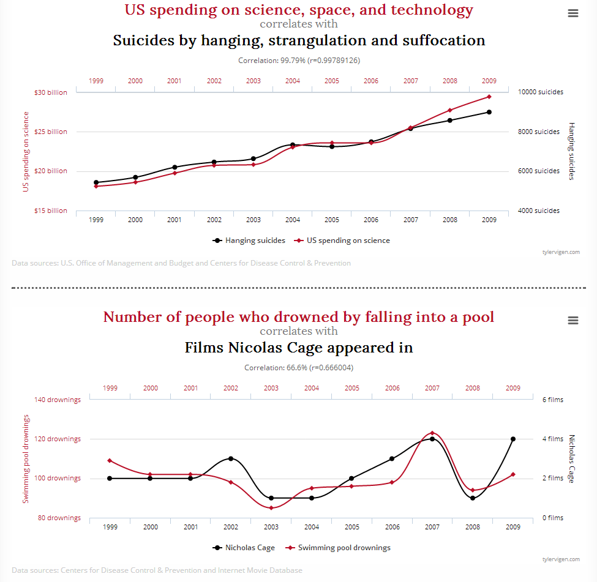

# Correlation, Confounding, and Causation

## What a model can measure, and what may be claimed {.unnumbered}

::: {.column-margin .margin-legend}
**Margin legend**

**DEF** — definition **KEY** — key idea to remember **↪** — bridge to another lecture **⚠** — common pitfall
:::

## Where this chapter fits

This chapter completes the second lecture day, and it marks a deliberate turning point. A fitted regression produces an estimate, a standard error and a *p*-value for the relationship between a predictor and a response. It does so whether or not that relationship has any meaningful interpretation.

That is the uncomfortable fact this chapter confronts:

**A model measures association; it does not, by itself, justify a causal claim.**

The coefficient for `temperature` in a regression states how the expected response changes as temperature changes *in the data at hand*. It does not state whether temperature *causes* the response to change.

The difference between these two statements is important. Confusing association with causation leads to incorrect scientific conclusions, misleading publications and, in some cases, poorly designed public-health policy. Closing this gap is not primarily a matter of building a more sophisticated model. It is a matter of **experimental design and reasoning**. That is why this is an experimental-design chapter, even though it introduces no new modelling technique.

## From variance to confounding

The chapter connects directly to the previous chapter on experimental design, where the variance was partitioned into named sources. One of these — **SSU, the variation due to unknown factors, confounders and lurking covariates** — was identified as particularly dangerous.

This chapter is, in effect, the story of SSU: what happens when these unknown factors are ignored, how they can create relationships that do not exist, and how the tools of experimental design — above all **randomisation** — protect against them.

One idea from the first design chapter should be kept in view:

> A **confounder** is a variable that was not intended for study but that nevertheless influences the response and is related to the **predictor**.

Randomisation is powerful because it breaks these unwanted relationships. It turns potential sources of systematic bias into random variation — noise that can be accounted for statistically.

## Three ways to be misled

Three phenomena are explored, each illustrated with a small, fully reproducible simulation:

- **Spurious correlation:** an apparent relationship that arises purely by chance.
- **Confounding:** a genuine common cause creates the appearance of a direct relationship between two variables.
- **Simpson's paradox:** a confounder strong enough to reverse the apparent relationship between two variables.

The chapter concludes by making precise what separates **observational data**, where these traps are common, from **experimental data**, where careful design — especially randomisation — can guard against them.

The central message is simple: **statistical models can quantify relationships, but design and reasoning are what permit their causal interpretation.**

## The fallacy, named

The fallacy at the centre of the chapter has a traditional Latin name, and naming it makes it easier to recognise:

> *Cum hoc ergo propter hoc* — "with this, therefore because of this." The error of concluding that because two things occur together, one must cause the other.

Determinism and causation have occupied philosophers for centuries — Spinoza, who lived and worked near Leiden, held that every event follows necessarily from prior causes — but the practising scientist requires something narrower than a metaphysics: a working rule for when data earn a causal claim. The remainder of this chapter builds that rule from the ground up, starting from the weakest kind of evidence — correlation alone.

{width="60%"}

## Spurious correlation: relationships from nothing

The most direct way to appreciate the problem is to consider two quantities that are strongly correlated and obviously unrelated. A well-known collection of such examples exists (@fig-spurious), and the examples are memorable precisely because the mechanism is absurd. No one believes that Nicolas Cage causes drownings. Yet the correlation coefficient is real, computed from real data, and large.

{#fig-spurious width="85%"}

Two routes produce such correlations, and it is important to distinguish them.

The first is **shared trends**. Many quantities drift upward over time — population, prices, cumulative counts of almost anything. Any two upward-drifting series will correlate highly with each other for no deeper reason than that both increase. The correlation is real but carries no information about a link between the two.

The second is **pure chance**, which is more insidious because it does not even require a trend. If enough correlations between unrelated variables are computed, some will be large by chance alone. This is not a rare event; it is a near-certainty once one goes looking. How common it is can be measured exactly by simulation. Two completely independent random walks — series that share no cause whatsoever — are correlated, and the exercise repeated 1000 times.

```{r spurious-walks}
set.seed(7)
walkcor <- replicate(1000, {
  a <- cumsum(rnorm(30))     # one random walk
  b <- cumsum(rnorm(30))     # a totally independent second walk
  cor(a, b)
})

mean(abs(walkcor) > 0.7)     # fraction of independent pairs with |r| > 0.7
```

Roughly one pair in six of these entirely unrelated series shows a correlation above 0.7 in absolute value — a value most biologists would describe as "strong". The two series have no common cause, no link, nothing; the correlation is manufactured entirely by the accumulation of random steps. This is the engine behind every gallery of spurious correlations: search enough trending series and large correlations are guaranteed.

The lesson is not that correlation is useless. It is that **a correlation coefficient is a description, not an explanation.** On its own it cannot distinguish a real mechanism from a shared trend or a chance coincidence. Something more is needed, and the first thing to rule out is a common cause.

## Confounding: the common cause

The most important reason two variables correlate without one causing the other is a **confounder**: a third variable that influences both. This is SSU from the design chapter, now placed at the centre. The structure is worth drawing, because once it has been seen it will be recognised everywhere.

```{r confound-figure, fig.width = 8, fig.height = 3.4, fig.align='center'}
plot(NA, xlim = c(0, 10), ylim = c(0, 5), axes = FALSE, xlab = "", ylab = "")

node <- function(xc, yc, lab, sub, fill) {
  rect(xc - 1.6, yc - 0.55, xc + 1.6, yc + 0.55, col = fill,
       border = "grey30", lwd = 1.5)
  text(xc, yc + 0.15, lab, font = 2, cex = 1.1)
  text(xc, yc - 0.25, sub, cex = 0.85, col = "grey25")
}

node(5, 4.2, "Z: confounder",  "e.g. species",        "#FAEEDA")
node(2, 1.3, "X: predictor",   "e.g. body mass",      "#E1F5EE")
node(8, 1.3, "Y: response",    "e.g. metabolic rate", "#EEEDFE")

arrows(4.1, 3.7, 2.8, 1.9, lwd = 2, length = 0.15, col = "#BA7517")   # Z -> X
arrows(5.9, 3.7, 7.2, 1.9, lwd = 2, length = 0.15, col = "#BA7517")   # Z -> Y
segments(3.6, 1.3, 6.4, 1.3, lwd = 2, lty = 2, col = "grey55")        # X ~ Y
text(5, 1.72, "observed correlation", cex = 0.85, col = "grey40")
text(5, 0.95, "(not a direct cause)", cex = 0.85, col = "grey40")
```

The confounder $Z$ sits above and drives both $X$ and $Y$ through the solid arrows. As a result $X$ and $Y$ move together — the dashed line — even if $X$ has no effect on $Y$ whatsoever. An analyst who measures only $X$ and $Y$, and never considers $Z$, will observe a clean correlation and be tempted to call it causal.

Exactly this situation can be constructed and a model observed being misled. Here $Z$ is a genuine common cause; $X$ is generated from $Z$; and $Y$ is generated from $Z$ *with no dependence on* $X$ at all. The true effect of $X$ on $Y$ is precisely zero, by construction.

```{r confound-sim}
set.seed(3)
N <- 200
Z <- rnorm(N)                 # the confounder
X <- 2 * Z + rnorm(N)         # Z influences X
Y <- 3 * Z + rnorm(N)         # Z influences Y — but X does NOT
```

The model a careless analyst would fit — `Y ~ X`, ignoring the confounder — is now fitted and the coefficient for `X` read off.

```{r confound-naive}
naive <- lm(Y ~ X)
round(summary(naive)$coefficients, 4)
```

The model reports a large, overwhelmingly "significant" effect of `X` on `Y`. It is entirely an artefact. `X` does nothing to `Y`; the association is the shadow of `Z` falling across both. A p-value of essentially zero here is not evidence of a real effect; it is evidence of how confidently a model will report a relationship that does not exist when a confounder is omitted.

The size of the artefact is not arbitrary; it can be predicted. Suppose the truth is $Y = \beta_X X + \beta_Z Z + \varepsilon$ and $Z$ is left out. The naive slope is $\operatorname{Cov}(X, Y)/\operatorname{Var}(X)$, and substituting the truth for $Y$ gives

$$\hat\beta_X^{\text{naive}} \;\longrightarrow\; \beta_X + \beta_Z\,\frac{\operatorname{Cov}(X, Z)}{\operatorname{Var}(X)} .$$

The second term is the **omitted-variable bias**. It is zero only if the confounder has no effect on the response ($\beta_Z = 0$) or is uncorrelated with the predictor ($\operatorname{Cov}(X, Z) = 0$). In the simulation $\beta_X = 0$, $\beta_Z = 3$, $\operatorname{Cov}(X, Z) = 2$ and $\operatorname{Var}(X) = 2^2 + 1 = 5$, so the naive slope should be close to $3 \times 2/5 = 1.2$.

```{r confound-bias}
c(naive_slope = unname(coef(naive)["X"]),
  predicted   = 3 * cov(X, Z) / var(X),
  theory      = 3 * 2 / 5)
```

The formula also explains why randomisation works: assigning $X$ at random forces $\operatorname{Cov}(X, Z) = 0$ for every $Z$, measured or not, and the bias term vanishes.

The remedy, when the confounder has been *measured*, is to include it in the model. Adding `Z` as a covariate asks the model to compare observations *at the same value of Z*, which removes the common cause from the comparison.

```{r confound-adjust}
adjusted <- lm(Y ~ X + Z)
round(summary(adjusted)$coefficients, 4)
```

With `Z` in the model the coefficient for `X` collapses to essentially zero and its p-value becomes large — the correct answer. This is the lesson to carry into every regression in this course: **the same data can yield opposite conclusions about `X` depending on which covariates the model contains.** Choosing that set is not a statistical decision the software can make; it is a scientific judgement about which variables are confounders, and it must come from knowledge of the biology.

There is a sharp qualification, and it is the reason design matters more than adjustment. `Z` can only be included in the model if someone *thought to measure it.* An **unmeasured** confounder — one never identified, the true residue of SSU — cannot be adjusted for at all. No ingenuity applied to the data at hand will recover from a common cause that was never recorded. This is precisely why the design chapter placed such weight on randomisation, and the resolution is returned to at the end.

### Integration: the two confounding fits

The two regressions on the same simulated data differ only in the presence of `Z`, and their conclusions about `X` are opposite. The naive fit reports a strong effect; the adjusted fit reports none, which is the truth by construction. The comparison establishes three points: a confounder can manufacture an apparent effect of any size; adjustment removes it, but only for confounders that were measured; and the decision about what to adjust for is scientific rather than statistical. The next section shows that the same mechanism can do more than manufacture an effect — it can reverse a real one.

## Simpson's paradox: when the confounder reverses the story

Confounding can do something more dramatic than manufacture an effect that does not exist: it can invert the sign of one that does. A relationship that is negative within every subgroup can appear positive when the subgroups are pooled. This is **Simpson's paradox**, and it is the most vivid demonstration in statistics that a confounder is not a nuisance to be mentioned in the discussion section — it can reverse the conclusion entirely.

Consider a biological example. Body mass and a mass-related response are measured across three species. Within each species the response *decreases* with mass — a real, consistent, negative biological relationship. But the three species differ: larger species tend to have both greater mass *and* a higher baseline response. Species, in other words, is a confounder of the mass–response relationship. It is simulated below, each species built term by term so that the structure is explicit.

```{r simpson-sim}
set.seed(1)

make_species <- function(n, mass_mean, base, slope = -1.2) {
  mass <- rnorm(n, mass_mean, 3)
  resp <- base + slope * (mass - mass_mean) + rnorm(n, 0, 2)
  data.frame(mass, resp)
}

# three species: bigger species have higher mass AND higher baseline response
d <- rbind(
  within(make_species(40, 20, 30), species <- "A"),
  within(make_species(40, 30, 45), species <- "B"),
  within(make_species(40, 40, 60), species <- "C")
)
d$species <- factor(d$species)
```

The data are examined in two ways. First, species is ignored entirely and the pooled relationship fitted — the analysis that would be run if which species each animal belonged to had never been recorded.

```{r simpson-pooled}
pooled <- lm(resp ~ mass, data = d)
coef(pooled)[["mass"]]        # pooled slope
```

The pooled slope is positive: across all the data, the response *rises* with mass. The same relationship is now fitted *within* species, by including species in the model.

```{r simpson-adjusted}
adjusted <- lm(resp ~ mass + species, data = d)
coef(adjusted)[["mass"]]      # within-species slope
```

The within-species slope is negative — the opposite sign, and close to the −1.2 that was simulated. Both numbers are correct; they answer different questions. The pooled slope answers "if a heavier animal is selected from this whole collection, is its response higher?" — and the answer is yes, because heavier animals tend to belong to the larger species, which have higher baselines. The within-species slope answers "if this animal were heavier *for its species*, would its response be higher?" — and the answer is no. The confounder has reversed the sign.

A picture makes the reversal unmistakable. Each species forms its own downward-sloping cloud, but the clouds are stacked upward and to the right, so a single line through all the points slopes upward.

```{r simpson-plot, fig.width = 7.5, fig.height = 5, fig.align='center'}
plot(resp ~ mass, data = d, col = c("#1D9E75", "#BA7517", "#7F77DD")[species],
     pch = 19, xlab = "Body mass", ylab = "Response",
     main = "Simpson's paradox: within-species down, pooled up")

# within-species regression lines (negative)
for (sp in levels(d$species)) {
  sub <- d[d$species == sp, ]
  fit <- lm(resp ~ mass, data = sub)
  clip(min(sub$mass), max(sub$mass), -100, 200)
  abline(fit, col = c("#1D9E75", "#BA7517", "#7F77DD")[which(levels(d$species) == sp)],
         lwd = 2)
}
do.call("clip", as.list(par("usr")))              # reset clip region
abline(pooled, col = "black", lwd = 3, lty = 2)   # pooled line (positive)
legend("topleft", bty = "n",
       legend = c("Species A", "Species B", "Species C", "Pooled (ignores species)"),
       col = c("#1D9E75", "#BA7517", "#7F77DD", "black"),
       lwd = c(2, 2, 2, 3), lty = c(1, 1, 1, 2))
```

The three coloured lines all descend; the dashed black line ascends. Which is "the" relationship between mass and response? Neither, on its own: the question is incomplete until *within a species* or *across species* is specified, and only knowledge of the biology determines which is meant. What must not be done is to fit the pooled line, ignore species, and report a positive effect of mass. That is a true statement about a meaningless quantity.

### Integration: the Simpson case

The pooled slope, the within-species slope and the plot are three views of one dataset, and they agree once the question is stated precisely. The pooled coefficient describes the between-species gradient, which is dominated by the confounder; the adjusted coefficient describes the within-species relationship, which is the one that was simulated; the plot shows why the two differ in sign. Simpson's paradox is therefore the strongest possible argument for the habit this chapter teaches: **before any relationship is trusted, it must be asked what it is not adjusted for.**

## Observational versus experimental data

Everything above concerns **observational** data — data in which variables were measured as they were found, without intervention. The predictor took whatever values nature assigned it, and nature may well have assigned those values *using the confounder*. In the Simpson example, an animal's mass and its species arrived together; neither was set by the investigator. That entanglement is exactly what allows a confounder to operate.

An **experiment** breaks the entanglement, and this is the deep reason the first design chapter placed randomisation at its centre. When *the investigator* assigns the value of the predictor — deciding, by a coin flip, which plot receives the fertiliser or which animal receives the dose — every arrow that would otherwise run *into* the predictor from a confounder is severed. The predictor no longer depends on species, on baseline health, or on any lurking $Z$, because it depends only on the randomiser. With those incoming arrows cut, a correlation between predictor and response can no longer be explained by a common cause. That is what earns the causal claim.

This yields a clean statement of the difference in the terms of this course:

- In **observational** data, a predictor's coefficient estimates an *association*. It is vulnerable to every confounder that was not measured, and — as the confounding and Simpson examples showed — that vulnerability can make the estimate not merely imprecise but *qualitatively wrong*, even reversed. Adjustment helps only for the confounders that were recorded.
- In **experimental** data with randomised assignment, a predictor's coefficient estimates a *causal effect*. Randomisation has, on average, balanced every confounder — measured and unmeasured alike — across the treatment groups, so no common cause remains to explain the association away.

Neither kind of data is "better" in the abstract. A great deal of biology — ecology, epidemiology, evolution, anything at large spatial or temporal scale — simply cannot be randomised, and observational data are all that exist. The point is not to disdain observation but to *know which regime one is in*, and to calibrate the language accordingly. From observational data one may say "is associated with", "predicts", "is linked to"; one may not say "causes". That verb must be earned, and only design earns it.

## Confounding when the aim is prediction

Everything above concerned the interpretation of a coefficient. A predictive model makes no such claim, and that changes the role of a confounder. A predictor does not need to be a cause to be useful: if a variable is associated with the outcome, and the association holds in the population where the model will be used, the model may legitimately use it. Grey hair predicts age without causing it.

The danger lies in the second condition. A model learns every association in its training data, including those created by how the data were collected, and it cannot tell the two kinds apart. A well-known example is a deep-learning model trained to detect pneumonia on chest X-rays from several hospitals [@Zech2018]. Pneumonia was much more common in some hospitals than in others, and the model learned to recognise *which hospital* an image came from, from details of the scanner and the labelling, and used that as a shortcut. It performed well on images from the same hospitals, and clearly worse on images from a hospital it had not seen. Hospital was a confounder of the association between image and disease, exactly in the sense of this chapter, and the model exploited it.

In bioinformatics the most common such shortcut is the batch: a sequencing run, a plate, a centre or an extraction date that happens to coincide with the outcome. The protection is the same as for causal questions, but applied for a different reason: balance the outcome over batches and centres in the design, record them, and evaluate the model on batches and centres it was not trained on.

::: column-margin
**KEY** — For prediction, a non-causal predictor is acceptable if its association with the outcome will still hold where the model is used. A confounder created by data collection will not.
:::

::: column-margin
**↪** The design chapter showed the same batch effect producing a false separation in a PCA plot. Day 7 shows how to keep related samples together when data are split for cross-validation; the same idea applies to batches and centres.
:::

## Key takeaways

- A model measures association. The causal interpretation of a coefficient is a scientific claim added on top, and it must be justified by design and reasoning, not by the fit.
- Correlation alone is the weakest evidence. High correlations arise from shared trends and from pure chance — as the random-walk simulation showed, a "strong" correlation between unrelated series is common, not rare.
- A confounder is a common cause of both predictor and response — the SSU of the design chapter. If it is ignored, a model will confidently report an effect that is entirely the confounder's shadow.
- A confounder that was *measured* can be adjusted for by including it in the model; the same data then give the opposite — and correct — conclusion. A confounder that was *not* measured cannot be adjusted for at all.
- Simpson's paradox is confounding at full strength: a relationship negative within every subgroup can appear positive when pooled. It must always be asked what a relationship is not adjusted for.
- Randomised assignment severs the arrows from confounders into the predictor, balancing measured and unmeasured confounders alike. This is why experiments license causal claims and observational studies, on their own, do not.
- The verbs must match the data. Observational data earn "is associated with"; only experimental data earn "causes".
- A predictive model needs association, not causation, but only an association that will still hold where the model is used. Confounders created by data collection (hospital, batch, scanner) are shortcuts that fail on new data.

## Looking ahead

The confounder that kept reappearing in this chapter, species in the Simpson example, is very often not a single covariate but a *grouping structure*: many observations sharing a common cause because they come from the same species, patient, plate or sequencing batch. That is the structure of dependence recognised in the design chapter and observed in the data-quality practical, and it returns on Day 7, where it decides how data may be resampled.

Two questions should be carried into every model fitted for the rest of the course. First: *what does this coefficient actually measure: an association, or an effect that may legitimately be called causal?* Second: *what has not been adjusted for, and is it a lurking common cause that could be inventing, concealing, or reversing the very thing about to be reported?* A machine-learning model is no protection here. It will happily use a batch effect as a predictor if the batch is confounded with the outcome.
