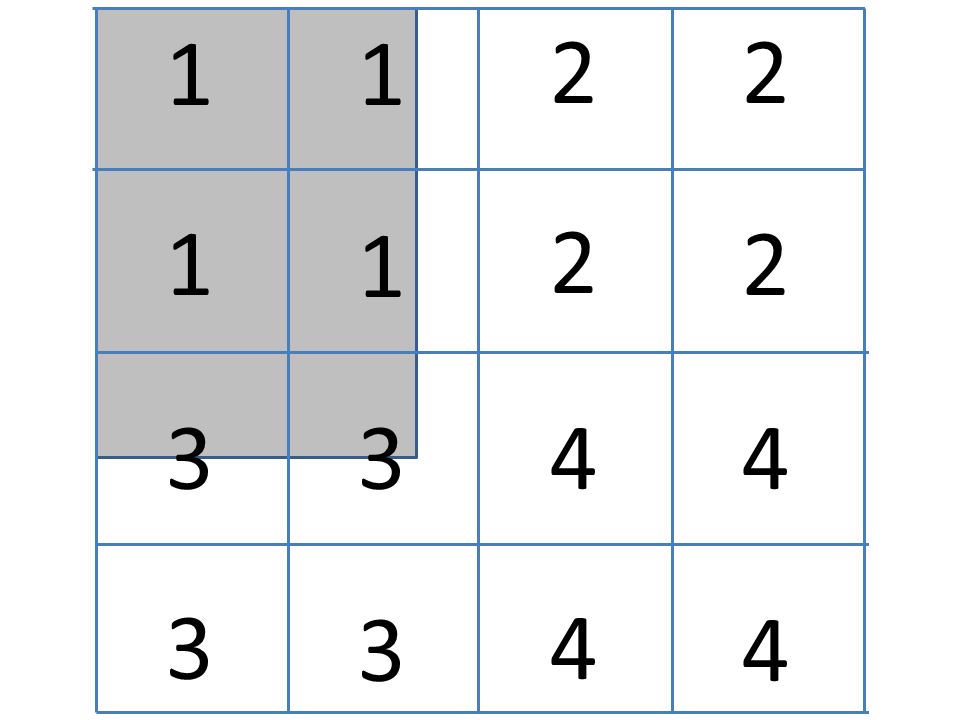
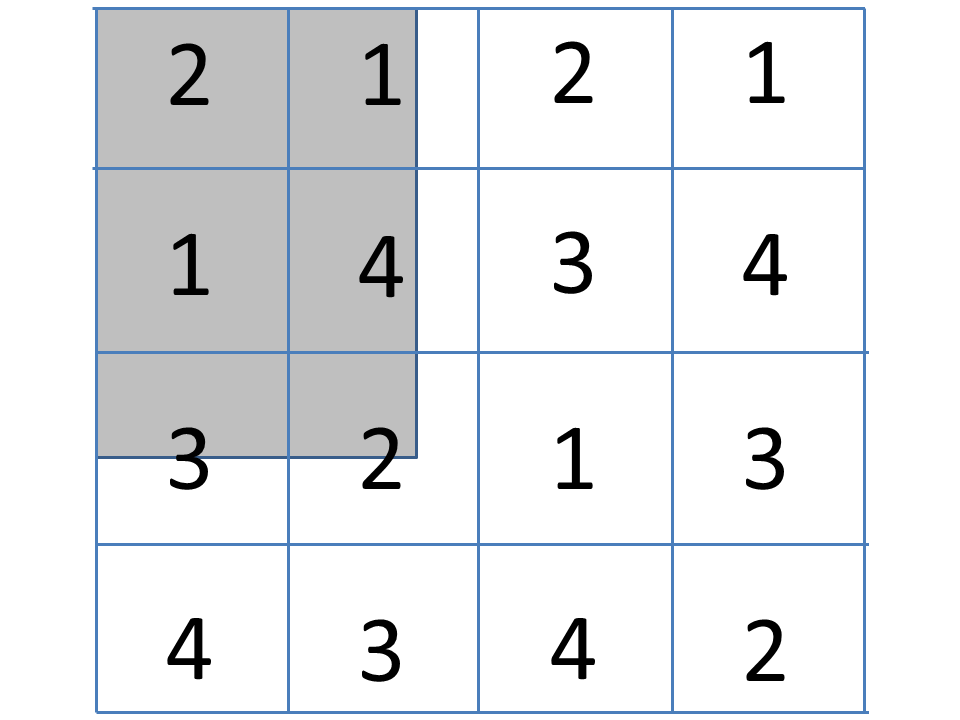
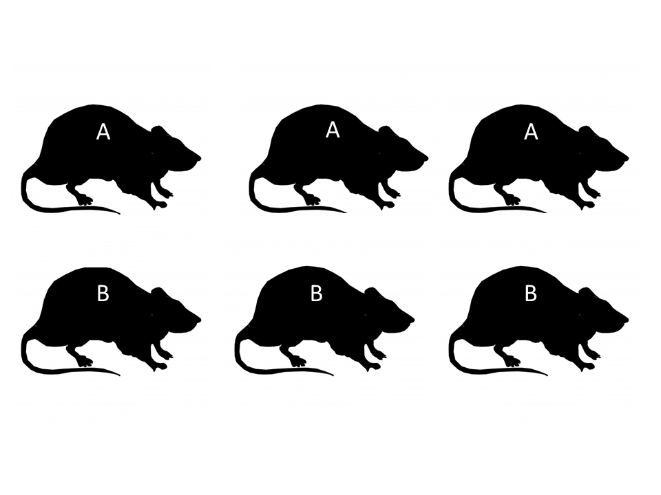
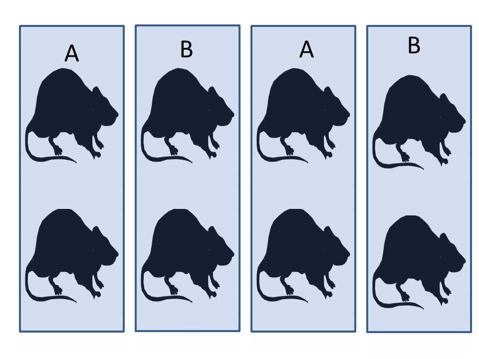
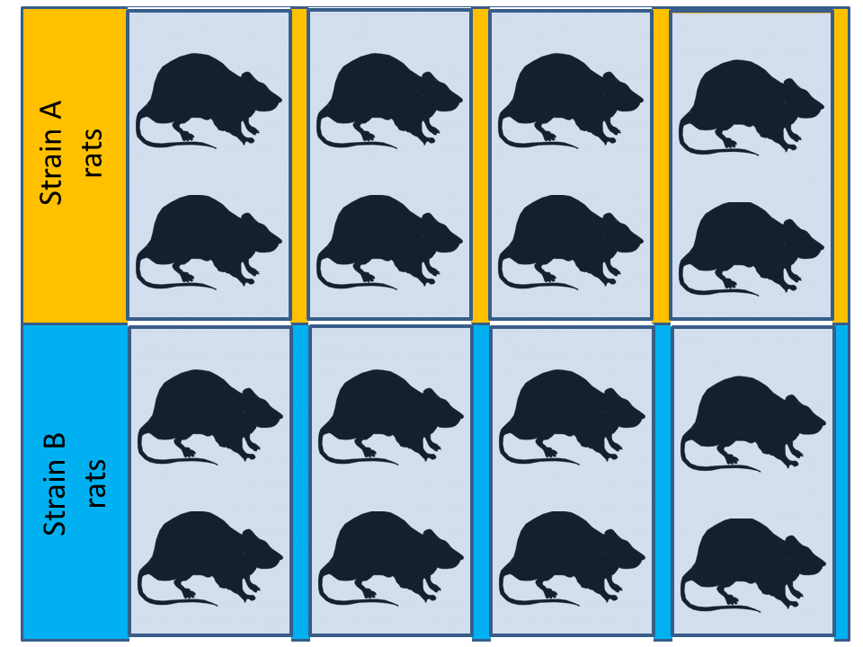
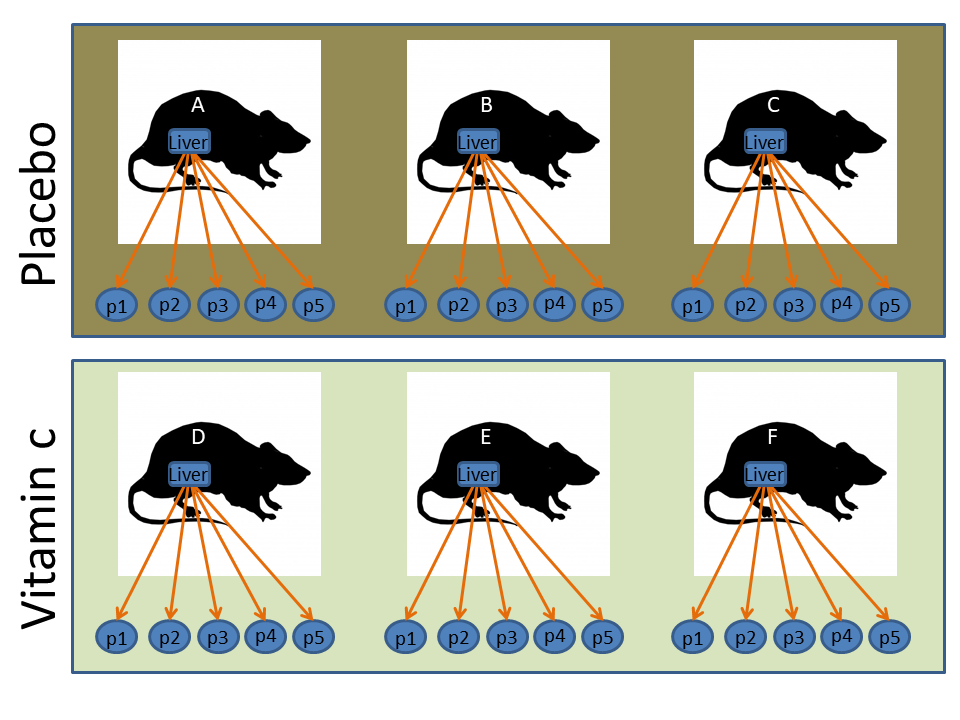

# Experimental Design

## Obtaining good data, and anticipating what will go wrong before it does {.unnumbered}

::: {.column-margin .margin-legend}
**Margin legend**

**DEF** — definition **KEY** — key idea to remember **↪** — bridge to another lecture **⚠** — common pitfall
:::

## Where this chapter fits

Day 1 showed that a statistical model is a rough approximation. It explains part of the variation in the data, and the rest ends up in the residuals. This chapter is about the step before the model, collecting data of which you know where the variation comes from. Without that, even a correct analysis gives answers you cannot trust. This holds for machine learning as much as for a classical test. A machine-learning method will usually not warn you that the data were badly collected. It simply learns whatever pattern is there, including the artefacts.

The chapter starts from a warning by Ronald Fisher:

> "To consult the statistician after an experiment is finished is often merely to ask him to conduct a post mortem examination. He can perhaps say what the experiment died of."
>
> — Sir Ronald Aylmer Fisher

Fisher's point is that the important decisions about a study are made *before* the first measurement. Once the data have been collected, their quality is fixed. The analysis can show how good the data are, but it cannot make them better. This chapter is therefore about the early decisions, and about the terms you need to reason about them precisely: type I and type II error, power, and the experimental unit.

Some of the ideas may look almost too simple. They are included because they are often violated without anyone noticing, and many of the problems discussed later in the course start there.

Four principles run through the chapter:

- In confirmatory research the hypothesis comes first and decides which data are collected. In exploratory research and in prediction the data come first. The design has to take that difference into account.
- A good method or model gives an **unambiguous** answer about the hypothesis: whatever the outcome, it is clear what it means.
- Every statement about a hypothesis is a statement about random variables. It is expressed as a *probability*, never as a certainty.
- Errors carry forward. Good statistics cannot rescue a poor research question, and a clever model cannot rescue poor data.

## Three kinds of question

Before any design decision, you have to know what kind of question the study asks. The course meets three kinds. They differ in what comes first: the hypothesis or the data.

- **Confirming a hypothesis.** The hypothesis comes first and decides which data are collected: what to measure, on whom, and how many. The study ends with a test. If the study was well designed and randomised, it may conclude that the treatment *causes* the effect. This is the world of Day 1 and of most of this chapter.
- **Exploring data to generate hypotheses.** The data come first, often thousands of genes measured at once. The analysis looks for structure: groups of patients, directions of variation, modules of co-expressed genes. What comes out is a *hypothesis*, not a conclusion, and it still has to be tested on other or new data. This is the world of PCA and clustering (Days 3 and 4).
- **Predicting an outcome.** The data come first here too, but what comes out is neither a conclusion nor a hypothesis to be tested later. The aim is to predict a label or a value for new cases: tumour or normal, responder or not. A fitted model is a hypothesis of its own: a claim that a particular rule links the measurements to the outcome. But that hypothesis is not tested; it is put to work. It makes predictions for new cases ("this tumour will respond"), and these are compared with what actually happens. The model is judged by how often, or by how much, it is wrong, and nothing is claimed about mechanism. **A rule can even be wrong as an explanation and still predict well**: yellow fingers predict lung cancer, although they do not cause it. Both are caused by smoking: smoking is a *confounder* of the relation between yellow fingers and lung cancer (the next chapter, [Correlation, Confounding, and Causation](02-confounding.qmd), returns to this). Significance and prediction really are different criteria. An effect can be highly significant and still predict individual cases poorly, and a model can predict well while none of its coefficients is significant on its own. This is the world of Days 7 to 10.

::: column-margin
**DEF** — **Hypothesis-driven** (confirmatory) research: the hypothesis selects the data. **Data-driven** (exploratory) research: the data select the hypothesis. **Predictive** research: the data build a model. The model is a hypothesis that is not tested but used, and it is judged by its predictions.
:::

::: column-margin
You *can* test whether a model predicts better than chance, for example by comparing its accuracy with the accuracy obtained after shuffling the labels. That tests the predictive power of the rule, not whether the rule is the right explanation.
:::

```{r fig-three-questions}
#| code-fold: true
#| code-summary: "Code for the diagram"
#| fig-width: 8.5
#| fig-height: 3.6
#| fig-cap: "Three kinds of question, read from left to right. The orange box marks the point where data enter that played no part in forming the hypothesis or building the model. In confirmatory research these are the data of the study itself, because the hypothesis was fixed before they were collected. In exploration and prediction they have to be new data, and these have to be planned in the design. In the Explore row the hypothesis goes on to a test. In the Predict row the model is the hypothesis: it is used to make predictions, and the outcome is an error rate."
box <- function(x, y, label, fill = "white", border = "grey30") {
  rect(x - 0.7, y - 0.28, x + 0.7, y + 0.28, col = fill, border = border, lwd = 1.5)
  text(x, y, label, cex = 0.8)
}
chain <- function(y, labels, fills, title) {
  xs <- seq(1.5, by = 1.8, length.out = length(labels))
  text(0, y, title, adj = 0, font = 2, cex = 0.85)
  for (k in seq_along(labels)) box(xs[k], y, labels[k], fills[k])
  if (length(xs) > 1) arrows(xs[-length(xs)] + 0.72, y, xs[-1] - 0.72, y, length = 0.07, lwd = 1.5)
}
new <- "#F6D7C3"; plain <- "white"
par(mar = c(0, 0, 0, 0))
plot(NA, xlim = c(0, 9.6), ylim = c(0.4, 3.6), axes = FALSE, xlab = "", ylab = "")
chain(3.1, c("hypothesis", "design", "new data", "test"), c(plain, plain, new, plain), "Confirm")
chain(2.0, c("data", "pattern", "hypothesis", "new data", "test"), c(plain, plain, plain, new, plain), "Explore")
chain(0.9, c("data", "model\n(hypothesis)", "prediction", "new data", "error"), c(plain, plain, plain, new, plain), "Predict")
```

The diagram shows why the distinction matters for design. A *p*-value, a confidence interval or an error rate is only honest when the hypothesis or model was fixed before the measurements used to compute it were looked at. Choosing variables for a reason is not the problem. That is what confirmatory research does, and the reason comes from earlier knowledge. The problem arises when the same measurements first suggest what to test and are then used to test it. In confirmatory research the order of events prevents this. In exploration and prediction the order is reversed.

Why is the reversed order a problem? If you search a data set for the strongest pattern, you will always find one that looks strong. That is partly due to noise: the pattern was picked precisely because it looked strong. Tested on the same data, it will look better than it is. Among 20,000 genes that are pure noise, the gene with the largest group difference will show a large difference and a small *p*-value. In new samples that difference largely disappears. (Exercise 2.2 shows the same for clusters.) An honest check needs data that were not searched: samples set aside before the analysis, or a second cohort. This cannot be arranged afterwards, so it belongs to the design. Decide before the study starts which samples are kept apart, and include them in the sample size.

The three kinds of question also allow different claims. A randomised experiment may claim a cause. An exploratory analysis may claim only that something is worth testing. A predictive model may claim an error rate for a stated population, and nothing about why it works [@Shmueli2010; @Breiman2001].

::: column-margin
**KEY** — A hypothesis cannot be tested on the data that suggested it. Exploration and prediction depend on design as much as a confirmatory test does. The difference is that their design must also provide the independent data for the check.
:::

Most of this chapter treats the confirmatory case, because its terms (experimental unit, randomisation, blocking, power) are needed everywhere else. The section [When the data come first](#sec-data-first) then shows what changes, and what stays the same, when the data come before the hypothesis.

::: {.callout-caution title="Check yourself"}
Classify each study as confirmatory, exploratory or predictive. (a) RNA-seq of 200 breast tumours, to find out whether there are subtypes not yet described. (b) A randomised trial of a drug against placebo, with blood pressure after eight weeks as the outcome. (c) A model that uses methylation at 500 CpG sites to tell whether a biopsy contains tumour cells.

::: {.callout-tip collapse="true" title="Answer"}
(a) is exploratory: the subtypes are the result, and they remain hypotheses until they are confirmed in other tumours. (b) is confirmatory: the hypothesis was fixed in advance, the treatment is randomised, and the trial ends in a test. (c) is predictive: the question is how often the model is right on new biopsies, not which CpG sites cause cancer. Real projects often combine the three. The design must then say which part of the study answers which kind of question.
:::
:::

## From data to facts

The purpose of an experiment is to turn measurements into a claim about the world that can be defended: to turn **data into facts**. That only works if a series of earlier decisions was made correctly. Each step below is a place where the argument can fail:

- **Input.** Everything begins with a research question. If the question is vague, no later step can make it precise.
- **Population.** You must define which objects the question is about: humans of a certain sex, age and location; a plant species under certain conditions. The researcher chooses this definition and is responsible for it.
- **Data acquisition.** The sample must represent the population. If it does not, nothing in the analysis can correct that.
- **Sample size.** The sample must be large enough to detect the effect of interest. Later in this chapter we calculate what "large enough" means.
- **Confounders.** A confounder is a variable that is not under study but meets two conditions: it affects the response, *and* it differs between the groups being compared, for example because the treated animals are on average older than the controls. (It must not itself be a consequence of the treatment.) Unless it is controlled for, by design or in the analysis, its effect is mistaken for an effect of the treatment: the estimated effect is biased.
- **Reproducibility.** The way the data were collected must be repeatable: by the same researcher later, and preferably by someone else.
- **Quality.** The quality of the data depends on how they were collected. The quality of the data in turn limits what any later analysis can show.

The last point is the main message of this chapter. Data quality is not something you check at the end. It is built in at the start, or it is missing.

## A model is where experimental design begins

For a confirmatory study, the link with Day 1 is this: before any measurement is made, the hypothesis is written down as the model that will be fitted. For a study of blood pressure, for example:

$$\text{Bloodpressure} \sim \text{Gender} + \text{Concentration} + \text{Time of day}$$

This one line already describes much of the design:

- **It states what is to be measured.** Every term is a column that must be recorded.
- **It states the data types**, and so the measurement method for each variable. Gender is nominal, concentration numerical, time of day ordinal or numerical, and the response numerical. Once you know the type, you know how the variable will be measured.
- **It states where variance will enter.** Every measured variable has a measurement error, and the way the data are collected (on which machine, by whom, on which day) adds variation of its own.

Measurement error comes in two kinds. Random error makes repeated measurements scatter around the true value; it adds variance, and we say the method has low **precision**. Systematic error shifts the measurements in the same direction; we say the method has low **accuracy**. A systematic error that is the same for every sample does not affect a comparison between groups: a balance that always reads 2 g too heavy still gives the correct difference between two groups. It becomes a problem only when it differs between the groups, as in the next example.

The variation added by collecting the data may be of no scientific interest, but it is still worth recording where it comes from. Suppose half of the samples are measured on machine A and half on machine B, and B reads 0.3 units higher. If the machine is recorded, it can be added to the model as an extra term. Its variation then gets its own sum of squares instead of ending up in the residuals. The residuals become smaller, and the test of the factor of interest gains power. If the machine is not recorded by the researcher, its variation stays in the residuals as noise. Worse, if most treated samples happened to go through machine B, the machine difference ends up in the estimated treatment effect: the estimate is *biased*. Recording such a factor costs one column in the spreadsheet; not recording it cannot be repaired later. This is what it means that statistics explains variance: *all* of the variance, including the parts of no direct interest.

::: column-margin
**DEF** — **Precision**: how close repeated measurements are to each other (random error, variance). **Accuracy**: how close the measurements are, on average, to the true value (systematic error).
:::

::: column-margin
**DEF** — **Bias**: a systematic difference between an estimate, for example of a treatment effect, and its true value. Unlike random error, bias does not become smaller when more samples are added. In this book the word is used only in this sense.
:::

The practical consequence is that you can write the header row of the spreadsheet before a single value is collected. You only need the model, the data types and the design.

| Bloodpressure | Gender  | Concentration |          Time of day | Note |
|---------------|:-------:|--------------:|---------------------:|-----:|
| Numerical     | Nominal |     Numerical | Ordinal or numerical | Text |

This header row is not a formality. It is the model written out as columns. Each row will hold **one experimental unit** (a term defined later in this chapter). Once the rows are filled in, the data are already in the form the planned analysis needs.

## Where does the variation come from?

On Day 1 the total variation was split into two parts: the part explained by the model, and the residuals. For design it helps to split it further, into named sources:

$$SST = SSH + SSR + \underbrace{(SSE + SSM + SSU)}_{\textbf{residual}}$$

Each letter names a source of variation. (These names are used in this chapter only; other textbooks use SSE and SSR for different things.)

- **SSH — the hypothesis.** Variation due to the conditions the hypothesis is about. This is the signal you want to detect. In the chicken example of Day 1 it was the between-feed sum of squares.
- **SSE — the experimental unit.** Natural variation between units: one rat is not the same as another rat. This is biological noise. It cannot be removed, and it does no harm except that it costs power.
- **SSR — repeated or longitudinal structure.** Variation that arises when the same unit is measured more than once, for example at several time points or in several biopsies of one patient. If this structure is not in the model, it also ends up in the residuals. On Day 7 it decides how data may be split: whole patients or plates, not single rows, are left out together.
- **SSM — measurement.** Variation and systematic error added by measuring: instrument drift, calibration error, differences between operators.
- **SSU — the unknown.** Variation from factors nobody identified: confounders that were not recorded and other variables that were not measured.

The last three terms together form the residual of Day 1. They do not all behave in the same way. SSE is the noise the model expects: independent, with roughly the same spread everywhere. SSM and SSU can break the assumptions of the analysis. A drifting instrument makes the residuals of later samples larger than those of earlier ones, so the variance is no longer equal. A single mislabelled sample becomes an outlier. Worst of all, an unknown factor can by chance coincide with the treatment, and its effect is then reported as a treatment effect. **Much of experimental design is about keeping SSM and SSU out of the part of the variation that will later be attributed to the hypothesis.**

## What must be considered before starting

Two groups of questions should be answered before the experiment begins.

*Effect and variation in the system itself.* Above all: how large is the effect you expect, and is an effect of that size biologically relevant? You need a number. For the power calculation later in this chapter, the number that matters is the smallest effect that would still be biologically relevant, not the effect you hope to find. It can come from the literature, from earlier experiments, or, clearly labelled as such, from an educated guess. You also need an estimate of how much the response varies between units. Without these two numbers, you cannot calculate how many samples are needed.

*Variance and bias added by doing the experiment.* How much noise does the experiment itself add? Think about the distribution of the random measurement error; systematic error from sensor drift or from outside conditions such as the weather; the variation within each block of the design (which is later modelled as a random effect); and differences between laboratories or analysts. Then think separately about sources of **bias**. The most obvious source is the researcher. Someone who hopes for a particular result can, without noticing, steer the many small choices a study requires: which animals to include, which measurements to repeat, when to stop collecting data.

## The four levers: control, randomisation, replication, blocking

The aim of experimental design is to stop unwanted variables from distorting the result. You either reduce their effect, or you record them and put them in the model. A good design increases the power and precision of the analysis without extra samples: the data are not more numerous, only better structured. Experimental design has four classical levers, and the rest of this part takes them in turn: **control, randomisation, replication and blocking.**

### Control

A control is a comparison built into the design so that the result can be interpreted. Different problems need different kinds of control:

- **Negative control (the $H_0$ comparison).** The treatment without its active ingredient, for example an injection of the insulin solution *without* the insulin. Comparing the treatment with a negative control is the most direct test of the null hypothesis.
- **Positive control (the $H_A$ check).** A condition that is certain to produce an effect, for example a deliberately high concentration. It shows that the setup can detect an effect at all. If the positive control shows nothing, a negative result for the treatment means nothing either.
- **Initial-conditions control.** A baseline measurement used to correct for drift. For example, you record the signal of a pH electrode before the manipulation, so that its slow drift can be subtracted afterwards.

Each control targets a specific term of the variance partition. The negative control separates SSH from the rest; the initial-conditions control removes part of SSM.

### Randomisation

Randomisation protects against SSU: the confounders, known and unknown. When treatments are assigned at random, factors that were not controlled cannot line up systematically with the treatment. What would have been bias becomes ordinary noise. Randomisation protects against three different problems:

- **Systematic design artefacts.** A non-random pattern in the physical layout: a moisture gradient across a field, a temperature gradient across a 96-well plate, wells at the edge of a plate that evaporate faster.
- **Unconscious bias.** Non-random structure that enters without anyone intending it, through the many small choices an experimenter makes.
- **Human "randomness".** People are very poor at producing random sequences by hand. The sequences they write down contain patterns that can be predicted.

### A worked example: the shaded field

Consider a field of 16 plots (or a plate of 16 wells), with treatments 1–4 assigned in neat columns. Suppose one edge of the field is in shade for part of the day. The plots there get fewer hours of sun and grow less. Because the layout is systematic, the shade falls mostly on treatments 1 and 3. The shade, an SSU effect, is now confounded with treatment: the analysis will report a "treatment effect" that is partly an effect of sunlight.

{#fig-field width="70%"}

When the treatments are assigned to the plots at random, the shade no longer lines up with the treatment. It is spread over all four treatments. By chance, one treatment may still have somewhat more shaded plots than another. But, and this is the key point, **that imbalance becomes smaller as more replicates are added.** Randomisation together with replication turns a confounder into ordinary noise.

{#fig-field-random width="70%"}

### Unconscious bias

Unconscious bias is hard to detect, because the choices seem reasonable at the time. Each of the following examples sounds acceptable until you look at it a second time:

- Testing food preference "in humans" with a taste panel of women over 55. The result says something about women over 55, not about humans in general.
- Studying the effect of adrenaline on skeletal muscle using only young mice.
- Assigning "the first ten larvae out of the box" to treatment 1 and the next ten to treatment 2. The order in which larvae are caught is not random: the active and the bold are caught first.

Apart from biology, cost, ethics and time also push designs towards the convenient choice. No statistical method corrects for this. The only defence is to keep questioning your own choices, and to know the forms this bias usually takes.

### A subtle case: spatial confounders

Suppose you must select 10 trees "at random" from a forest to test a pest-control chemical. A tempting method is to close your eyes, put a finger on ten points of the map, and take the tree nearest to each point.

This is not a random sample of trees, because trees are not evenly spread. Every tree "owns" the part of the map that is closer to it than to any other tree, and its chance of being chosen equals the size of that part. A tree in a dense cluster owns only a small area, because its neighbours are close. An isolated tree, near a clearing or a pond, owns a large area. The points are random over the *map*, but the trees chosen are mostly *isolated* trees. These may differ systematically from the trees inside the stand: they get more light and have less competition. The spatial structure has become a confounder.

The two panels below show the trap. The left panel shows the "random" points on the map. The right panel adds where the trees actually grow (the shaded clusters).

```{r spatial-confounder, fig.width = 8, fig.height = 4, fig.align='center'}
#| code-fold: true
#| code-summary: "Code for plot below"
#|
set.seed(234)
x <- runif(50, 0, 10)
y <- runif(50, 0, 10)

op <- par(mfrow = c(1, 2), mar = c(3, 3, 3, 1))

plot(x, y, col = "blue", pch = 19, main = "Points dropped 'at random'",
     xlab = "", ylab = "")

plot(x, y, type = "n", main = "...but trees are not uniform",
     xlab = "", ylab = "")
polygon(c(0, 0.5, 2, 3, 4), c(10, 8.2, 8, 9.3, 10), col = "lightblue", lwd = 1)
polygon(c(5.4, 6.0, 6.1, 5.8), c(3, 3.3, 4, 3.8), col = "lightblue", lwd = 1)
points(x, y, pch = 19, col = "blue")

par(op)
```

Most points fall outside the clusters. Each of them selects the nearest tree, which is usually an isolated tree or a tree at the edge of a cluster. A tree in the middle of a cluster is chosen only if a point lands right next to it. The isolated trees are therefore chosen far too often.

The remedy is to take space out of the selection. Number every tree and draw the numbers at random, by computer or from an urn. Every tree then has the same chance of being chosen, wherever it stands.

### Replication — and the experimental unit

Before you can count replicates, you must know *what* is being replicated. This is the most misunderstood idea in this chapter, and getting it wrong is the classic route to a wrong analysis.

> The **experimental unit** is the smallest division of the experimental material such that any two units could receive different treatments, independently of each other.

In other words: all measurements *within* one experimental unit necessarily get the same treatment. Suppose six measurements share a plot, a cage or a subject, and the treatment is given to that plot, cage or subject as a whole. Then the plot, cage or subject is the experimental unit, not the single measurement. The number of *independent* replicates is the number of experimental units. That number, not the number of measurements, determines the degrees of freedom for testing the treatment.

The idea is easier to see in examples. Four cases follow. For each case, first answer two questions yourself: *what is the experimental unit, and how many independent replicates are there?*

{#fig-rats1 width="70%"}

**Case 1 — individually injected rats.** Six rats are each *individually injected* with either a placebo or vitamin C, three per group. Each rat gets its own injection, independently of the others. The **rat is the experimental unit**, and there are six independent replicates: three per treatment.

{#fig-rats2 width="80%"}

**Case 2 — rats sharing a box.** The vitamin C is now given through the drinking water, and the rats live two to a box; each box gets one kind of water. The two rats in a box share the same water, the same temperature, and everything else specific to that box. They also compete for the water, and they can pass diseases to each other. Their measurements are therefore not independent. The **box is the experimental unit.** With two boxes per treatment there are four independent replicates, not eight, however many rats each box contains.

{#fig-rats3 width="80%"}

**Case 3 — nested strains.** The hypothesis is that aggression is related to the level of adrenaline in the blood at rest. It is tested with two rat strains that are known to differ in baseline adrenaline. Here the "adrenaline treatment" is not given to rats; it is a property of the *strain*. The treatment is **nested in strain**, and the strain is the experimental unit. With only two strains there are in effect two experimental units for the comparison, however many rats each strain contributes. Any other difference between the two strains is confounded with adrenaline. This is a weak design for the question, and it is worth recognising that *before* the experiment is run.

{#fig-rats4 width="70%"}

**Case 4 — pieces of one liver.** Rats A–C get a standard vitamin C diet, rats D–F a high one. Afterwards each rat's liver is cut into six pieces for fat-content analysis. It is tempting to count 36 replicates. But the six pieces of one liver come from the same animal, with the same genes and the same history: if that rat had liver disease, all six pieces carry it. The pieces are **nested in rat**; the **rat is the experimental unit**, and there are three replicates per diet. Analysing the 36 pieces as if they were independent is called *pseudoreplication*. It makes the result look far more certain than it is.

::: column-margin
**DEF** — **Pseudoreplication**: treating several measurements of one experimental unit as if they were independent replicates.
:::

The four cases have one thing in common. Measurements that share a box, an animal or a strain are **correlated**. If you treat them as independent, the analysis assumes there is more information than there is: the effective sample size is overstated, and the standard errors are too small. Recognising these dependencies now makes it possible to respect them later. On Day 7, boxes, strains and rats become the units that are resampled and held out together.

### Blocking

Blocking is the fourth lever. It is not an alternative to randomisation but a restricted form of it. Units that share a known nuisance factor are grouped into blocks, and the treatments are randomised *within* each block. This guarantees that every treatment meets the nuisance factor equally often, where complete randomisation achieves this only on average. Within each block, randomisation still protects against everything you do not know. In the analysis the block then becomes a term in the model, so that its variation is removed from the residuals. '**So the question is not *whether* to randomise, but whether there is a nuisance factor you know in advance**. If there is, randomise within blocks of it. If not, randomise over all units. In clinical trials the same idea is called *stratified randomisation*.

The shaded field shows all three options side by side.

- In the **systematic** layout the shade fell on treatments 1 and 3. The confounder was aligned with the treatment, and the analysis could not separate sunlight from the treatment effect.
- **Randomising** spread the shade over all four treatments. With enough replicates, its influence on the treatment comparison averages out. But the shade is still in the data: it ends up in the residuals, makes $\sigma$ larger, and so costs power.
- **Blocking** does better. If you know where the shade falls, you divide the field into blocks that are each uniform with respect to the shade: a shaded half and a sunny half. **Every treatment appears once in every block**, in random order within the block. This design is called a **randomised complete block design**. The difference in sunlight is now entirely a difference *between* the blocks. The analysis estimates it as a separate term and removes it from the residuals. It does not affect the treatment comparison, because every treatment received the same amount of shade.

```{r blocking-field, fig.width = 8, fig.height = 4.2, fig.align='center'}
#| code-fold: true
#| code-summary: "Plot generating code"
cols <- c(T1 = "#7F77DD", T2 = "#D85A30", T3 = "#1D9E75", T4 = "#BA7517")

plot(NA, xlim = c(0, 10), ylim = c(0, 5.2), axes = FALSE,
     xlab = "", ylab = "",
     main = "Randomised complete block: the same field, split along the shade")

# shade gradient: darker (less sun) on the left, fading to the right
ng <- 100
for (i in 1:ng) {
  rect((i - 1) * 10 / ng, 0.4, i * 10 / ng, 4.4,
       col = rgb(0.37, 0.37, 0.35, 0.40 * (1 - (i - 1) / ng)), border = NA)
}
text(0.4, 4.8, "Less sun", adj = 0, cex = 0.9)
text(9.6, 4.8, "More sun", adj = 1, cex = 0.9)

# the two blocks
rect(0.2, 0.5, 4.8, 4.3, border = "grey40", lty = 2, lwd = 1.5)
rect(5.2, 0.5, 9.8, 4.3, border = "grey40", lty = 2, lwd = 1.5)
text(2.5, 4.05, "Block 1 (shaded)", font = 2, cex = 0.95)
text(7.5, 4.05, "Block 2 (sunny)",  font = 2, cex = 0.95)

# helper: draw one plot cell
cell <- function(x, y, tr) {
  rect(x, y, x + 2, y + 1.4, col = cols[tr], border = "white", lwd = 2)
  text(x + 1, y + 0.7, tr, col = "white", font = 2, cex = 1.3)
}

# each block holds all four treatments, order randomised within the block
cell(0.5, 2.3, "T3"); cell(2.7, 2.3, "T1")
cell(0.5, 0.7, "T4"); cell(2.7, 0.7, "T2")
cell(5.5, 2.3, "T2"); cell(7.7, 2.3, "T4")
cell(5.5, 0.7, "T1"); cell(7.7, 0.7, "T3")
```

In the figure both blocks contain all four treatments, and the shade gradient runs between the blocks, not within them. The gain can be calculated. The block-to-block variation that randomisation left in the residuals is now removed from them, so $\sigma$ becomes smaller, and the power increases without extra samples (see the power section below). The same logic applies to every nuisance factor you can name in advance: the day of the week, the technician, the shelf in the incubator, the litter a mouse came from. Block what you can identify, and randomise within the blocks against what you cannot.

The block must then also be in the model. A blocked design analysed without the block term still gives an unbiased estimate of the treatment effect, but the block variation stays in the residuals, so the gain in power is lost. In short: analyse the way you randomised.

A block is a group of units that share conditions, just like the rats in one box. In bioinformatics the most familiar block is the sequencing or hybridisation **batch**: spread the biological groups evenly over the batches, and randomise the positions within each batch. A batch that is confounded with the biological groups cannot be repaired afterwards.

### Integration: the four levers as one strategy

Each lever acts on a different part of the variance partition:

- **control** makes the comparison interpretable, so that SSH can be separated and SSM corrected;
- **randomisation** turns the unknown SSU from bias into noise;
- **replication** at the level of the experimental unit determines how many independent observations of that noise there are;
- **blocking** (randomisation within blocks) balances known nuisance factors over the treatments and removes their variation from the residuals.

All four are decided before any data are collected. Together they determine the residual variance and its degrees of freedom: the yardstick against which the treatment effect will be judged. The next section makes that judgement quantitative.

## Type I and type II error, and power

We can now make "large enough" precise. A hypothesis test can be wrong in two different ways, and it is important to keep them apart.

A **type I error** is rejecting a null hypothesis that is true: declaring an effect that is not there. Its probability is $\alpha$, the significance level that you choose:

$$P(\text{reject } H_0 \mid H_0 \text{ true}) = \alpha$$

A **type II error** is not rejecting a null hypothesis that is false: missing an effect that is real. Its probability is $\beta$:

$$P(\text{not reject } H_0 \mid H_0 \text{ false}) = \beta$$

The **power** of a test is $1 - \beta$: the probability of detecting an effect that is really there.

$$\text{Power} = P(\text{reject } H_0 \mid H_0 \text{ false}) = 1 - \beta$$

So $\alpha$ is the risk of a false alarm that you accept, and the power is the chance of detecting a real effect. A good design fixes $\alpha$ and makes the power as large as possible.

### What drives power

You do not need the exact formula to see what drives power. A rough rule shows the direction of each factor:

$$\text{Power} \;\propto\; \frac{\text{effect size} \times \alpha \times \sqrt{n}}{\sigma}$$

Read it as a set of dials. It is a memory aid, not an exact formula; the exact version is in the box "Where the number 64 comes from" below. Three quantities in the numerator *increase* the power: a larger true **effect size**, a larger $\alpha$ (a less strict test), and a larger **sample size**. The sample size enters as $\sqrt{n}$, so each extra sample helps less than the one before: four times as many samples only doubles $\sqrt{n}$. One quantity in the denominator *decreases* the power: the residual standard deviation $\sigma$, the noise. This is why the first half of the chapter matters. Control, blocking and careful measurement all make $\sigma$ smaller, and every reduction of $\sigma$ increases the power without a single extra sample.

### Power as overlapping curves

The most useful picture shows two sampling distributions of the mean on the same axis: one under $H_0$ and one under $H_A$. The critical value, set by $\alpha$, marks the cut-off beyond which $H_0$ is rejected. The type I error is the tail of the *null* curve beyond the critical value. The type II error, $\beta$, is the part of the *alternative* curve that falls on the other side of the cut-off, where $H_0$ is not rejected. The power is the rest of the alternative curve: the part beyond the cut-off.

Each dial changes the picture in a predictable way. A larger effect moves the two curves further apart, so less of the alternative curve falls in the region where $H_0$ is not rejected: $\beta$ shrinks and the power grows. A smaller $\sigma$ makes both curves narrower, so again they overlap less. A larger $n$ also makes the curves narrower, because the spread of the mean is $\sigma/\sqrt{n}$. Every way to increase power comes down to *less overlap* between the two curves.

```{r overlap-curves, fig.width = 8, fig.height = 5, fig.align='center'}
#| code-fold: true
#| code-summary: "Code plot below"
Length_M <- seq(8, 26, 0.01)
Density  <- dnorm(Length_M, 18, 2)   # distribution under H0 (mean 18)
Density2 <- dnorm(Length_M, 15, 2)   # distribution under HA (mean 15)

# critical value from the H0 curve
Critm <- 18 - 2 * 2.048

plot(Density2 ~ Length_M, type = "l", col = "red", lwd = 3,
     ylab = "Density", xlab = "Sample mean",
     main = "Two distributions of the mean: power as non-overlap")

# beta: the part of the HA curve in the non-rejection region (right of critical value)
cord.x <- c(Critm, seq(Critm, 25, 0.01), 25)
cord.y <- c(0, dnorm(seq(Critm, 25, 0.01), 15, 2), 0)
polygon(cord.x, cord.y, col = "red")

# power: the part of the HA curve past the critical value (left tail here)
cord.x <- c(8, seq(8, Critm, 0.01), Critm)
cord.y <- c(0, dnorm(seq(8, Critm, 0.01), 15, 2), 0)
polygon(cord.x, cord.y, col = "darkgreen")

arrows(Critm, 0.06, Critm, 0.02, lwd = 3)
text(Critm, 0.07, "critical value")
text(16, 0.05, expression(beta), cex = 3)

lines(Density ~ Length_M, col = "blue", lwd = 3)  # H0 for reference
abline(0, 0); segments(15, 0, 15, dnorm(15, 15, 2), lty = 2)
```

The blue curve is **the sampling distribution of the mean** under $H_0$, the red curve the one under $H_A$. The red shaded area to the right of the critical value is $\beta$: the alternative is true, but the sample mean falls in the region where $H_0$ is not rejected. The green area to the left is the power. The calculations below all compute this green area, for different settings of the dials.

### Computing power in R

For the two-sample $t$-test, R computes the power in one line with `power.t.test`. The same function answers two different questions, depending on which argument you leave out.

**Post hoc: the study has been done. What power did it have?** You give $n$ and the effect size, and ask for the power. This is a check after the fact. Its proper use is to plan the next study, not to explain away a non-significant result.

```{r power-posthoc, echo = TRUE}
power.t.test(n = 15, delta = 1, sd = 2, sig.level = 0.05,
             alternative = "two.sided")
```

With 15 observations per group, a true difference of 1 and a standard deviation of 2, the power is about 0.26. A real effect of this size would be detected in about one study in four. A non-significant result from such a study tells you very little.

**A priori: the study is being planned. How many replicates are needed?** You give the power you want (0.8 is the usual minimum), the effect size and $\sigma$, and solve for $n$. This is the calculation that should come before the experiment, and it is exactly what Fisher's warning is about.

```{r power-apriori, echo = TRUE}
power.t.test(power = 0.8, delta = 1, sd = 2, sig.level = 0.05,
             alternative = "two.sided")
```

About 64 samples per group are needed, more than four times the 15 of the post-hoc example. The reason is the noise: when $\sigma$ is twice the effect size, many observations are needed to separate the signal from the residual variation.

Using power well therefore means making four decisions, in this order:

1.  Choose the type I risk you accept: set $\alpha$ (e.g. 0.05).
2.  Choose the minimum power you require, e.g. 0.8.
3.  Choose the smallest **biologically relevant** effect size: the smallest effect that would actually matter, not the smallest effect you could detect.
4.  Find a defensible estimate of $\sigma$: from the literature, from a similar experiment, or from a pilot study.

With these four numbers, an a priori calculation gives the required $n$. After the study, a post-hoc calculation reports the power that was actually achieved.

::: {.callout-note collapse="true" title="Where the number 64 comes from"}
The number 64 is not magic, and a short derivation shows where it comes from. Take two groups of $n$ observations with a true difference $\delta$ and a known standard deviation $\sigma$. The difference of the two sample means is normally distributed,

$$\bar x_1 - \bar x_2 \sim N\!\left(\delta,\ \frac{2\sigma^2}{n}\right),$$

so the test statistic $z = (\bar x_1 - \bar x_2)\big/\big(\sigma\sqrt{2/n}\big)$ is standard normal under $H_0$. Under $H_A$ it is shifted by $\delta\big/\big(\sigma\sqrt{2/n}\big)$. The null hypothesis is rejected when $|z| > z_{1-\alpha/2}$. If we ignore the very small chance of rejecting in the wrong direction,

$$\text{Power} \approx P\!\left(Z > z_{1-\alpha/2} - \frac{\delta}{\sigma\sqrt{2/n}}\right).$$

For this to equal $1 - \beta$, the shift must be $z_{1-\alpha/2} + z_{1-\beta}$. Solving for $n$ gives

$$n = \frac{2\,(z_{1-\alpha/2} + z_{1-\beta})^2\,\sigma^2}{\delta^2} \quad\text{per group.}$$

```{r power-formula, echo = TRUE}
delta <- 1; sigma <- 2
c(normal_formula = 2 * (qnorm(0.975) + qnorm(0.80))^2 * sigma^2 / delta^2,
  power.t.test   = power.t.test(power = 0.8, delta = delta, sd = sigma)$n)
```

The formula gives 62.8, and `power.t.test` gives about one more, because it uses the $t$ distribution: $\sigma$ has to be estimated from the data, and that costs a little power. The formula also makes the rough rule of the previous section exact. For a given $\alpha$, the power depends on the design only through $\delta\sqrt{n}/\sigma$. Halving the effect size, or doubling the noise, therefore requires *four times* as many units.
:::

### Power without a formula: simulation

`power.t.test` uses a formula. There is a more transparent way to find the power, and it works for any design, however complex: *simulate the whole experiment many times, and count how often it detects the effect.* It is worth doing this once yourself. It shows exactly what power means, and the practicals use the same skill.

First, one simulated experiment. We draw fifteen "males" from a normal distribution with mean length 18 and SD 2, and fifteen "females" with mean 17 and SD 2, and we run one $t$-test.

```{r sim-one, echo = TRUE}
set.seed(1)
Males   <- rnorm(15, mean = 18, sd = 2)
Females <- rnorm(15, mean = 17, sd = 2)
t.test(Males, Females)$p.value
```

This single p-value is one outcome of a random process. On its own it says nothing about power, because power is a long-run frequency. So we repeat the whole experiment 10,000 times, now with 20 animals per group, and record the fraction of runs in which the effect is detected ($p < 0.05$). That fraction *is* the power.

```{r sim-power, echo = TRUE}
pval <- numeric(10000)
for (i in 1:10000) {
  A <- rnorm(20, 18, 2)   # true difference is 1, SD is 2
  B <- rnorm(20, 17, 2)
  pval[i] <- t.test(A, B)$p.value
}
sum(pval < 0.05) / 10000   # estimated power at n = 20
```

The simulated power at $n = 20$ per group is about 0.34, the same value that `power.t.test` gives for these settings. The logic is explicit. We *know* the effect is real, because we built it in. Every run that fails to reject $H_0$ is therefore a type II error, and the fraction of such runs is $\beta$. If you change $n$ from 20 to 40 and run the loop again, the power rises: the same lesson as the rough rule, now obtained by counting instead of by a formula.

### The power curve

If you compute the power for a range of values of $n$ and plot it, you get a **power curve**, the most useful tool for planning. Where the curve crosses 0.8, you read off the required sample size. The code below computes the curve with `power.t.test`. A simulation would give the same curve, with some random scatter around it: the formula and the simulation compute the same quantity in two ways.

```{r power-curve, fig.width = 8, fig.height = 5, fig.align='center'}
NN    <- 3:200
Power <- power.t.test(n = NN, delta = 1, sd = 2, sig.level = 0.05,
                      type = "two.sample", alternative = "two.sided")$power
plot(Power ~ NN, type = "l", lwd = 3, ylim = c(0, 1),
     main = "Power curve for the two-sample t-test",
     xlab = "n per group", ylab = "Power")
segments(-5, 0.8, 64, 0.8, lty = 2)
arrows(64, 0.8, 64, 0.05, lty = 2)
text(64, 0.02, "n = 64")
```

The dashed lines mark the crossing: about 64 per group for a power of 0.8, with this effect size and noise level. That agrees with the a priori calculation above. A different effect size or a different $\sigma$ moves the whole curve. Power is not a property of the test alone; it is a property of the *design*.

### Integration: power as the summary of design

The three calculations of this section (`power.t.test` after and before the study, the simulation, and the power curve) are three views of one quantity. Power is determined by the effect size, the residual standard deviation, the significance level and the sample size, where the sample size is the number of experimental units. The design decisions from the first half of the chapter enter through $\sigma$ and $n$. Blocking and control make $\sigma$ smaller. Identifying the experimental unit correctly gives the true $n$. Randomisation makes sure that what remains in $\sigma$ is noise and not bias. A power calculation before the experiment is therefore the moment at which all earlier design decisions are checked against the effect the study aims to detect.

## When the data come first {#sec-data-first}

So far we assumed that the hypothesis was fixed before the data existed. From Day 3 onwards that is rarely the case. PCA and clustering search the data for structure; classifiers search them for whatever separates the labels. Experimental design still matters there. Some of its ideas carry over unchanged, some change their meaning, and one new requirement appears: an honest check on independent data must be planned before the study starts.

### Thousands of tests at once

Exploration often starts with one test per gene. Suppose 10,000 genes are measured in two groups of five samples, and *no gene differs at all*. What do the 10,000 p-values look like?

```{r many-tests}
#| code-fold: true
#| code-summary: "Code: 10,000 t-tests on genes that do not differ"
set.seed(2026)
m     <- 10000
n_per <- 5
expr  <- matrix(rnorm(m * 2 * n_per), nrow = m)   # rows are genes; no real differences
A     <- expr[, 1:n_per]
B     <- expr[, n_per + 1:n_per]

# a two-sample t-test for every gene at once
s2    <- (apply(A, 1, var) + apply(B, 1, var)) / 2
tstat <- (rowMeans(A) - rowMeans(B)) / sqrt(s2 * 2 / n_per)
pval  <- 2 * pt(-abs(tstat), df = 2 * n_per - 2)

hist(pval, breaks = 20, col = "lightblue", main = "",
     xlab = "p-value (no gene truly differs)")
```

The histogram is flat, and that is a theorem, not an accident. A p-value is constructed so that, when the null hypothesis is true, a p-value below 0.05 occurs 5% of the time, a p-value below 0.10 occurs 10% of the time, and so on: $P(p \le u) = u$ for every $u$. That is exactly a uniform distribution between 0 and 1. Testing $m$ true null hypotheses at level $\alpha$ therefore gives about $\alpha m$ "significant" results. The counts below use `m` and `pval` from the folded code above the histogram.

```{r many-tests-count}
c(significant_at_0.05 = sum(pval < 0.05),
  expected            = 0.05 * m,
  bonferroni          = sum(pval < 0.05 / m),
  benjamini_hochberg  = sum(p.adjust(pval, method = "BH") < 0.05))
```

[**DEF — Bonferroni.** Test each hypothesis at level $\alpha/m$. The probability of *any* false positive is then at most $m \cdot \alpha/m = \alpha$.]{.column-margin}

[**DEF — Benjamini–Hochberg.** Sort the p-values, $p_{(1)} \le \dots \le p_{(m)}$, find the largest $k$ with $p_{(k)} \le \frac{k}{m}\alpha$, and reject the $k$ smallest. This controls the *false discovery rate*: the expected fraction of false positives among the rejections.]{.column-margin}

About five hundred genes pass the uncorrected threshold, although none of them differs. The two standard corrections remove them. Bonferroni protects against even a single false positive, and it is strict. Benjamini–Hochberg accepts that a controlled fraction of the discoveries is false, and it is the usual choice in genomics. Either way, a p-value means little until you know how many tests were run.

::: column-margin
**KEY** — Testing thousands of genes is exploration: the data decide which hypotheses look interesting. A correction for multiple testing is the minimum; independent confirmation is the standard.
:::

::: {.callout-note title="Exercise 2.1 — 5,000 genes, two corrections"}
An expression study measures 5,000 genes in 6 control and 6 treated samples. You decide the truth: genes 1 to 250 are raised by 2.5 units in the treated samples; the other 4,750 genes do not change. All residuals are standard normal.

```{r}
#| eval: false
set.seed(505)
G <- 5000
X <- matrix(rnorm(G * 12), nrow = G)          # rows are genes, columns samples
X[1:250, 7:12] <- X[1:250, 7:12] + 2.5         # the truly changed genes
group <- rep(c("control", "treated"), each = 6)
truly_changed <- seq_len(G) <= 250
```

a. Compute a two-sample *t*-test (equal variances) for every gene, and make a histogram of the 5,000 p-values. Explain its shape: which part comes from the unchanged genes, and which from the changed ones?
b. How many genes have $p < 0.05$? How many of those are false positives (you know the truth)? How many did you expect?
c. Apply the Bonferroni correction (`p < 0.05 / G`) and the Benjamini–Hochberg procedure (`p.adjust(p, "BH") < 0.05`). For each, count the discoveries, the false positives, and the fraction of discoveries that is false.
d. Which correction would you use to choose genes for a follow-up experiment, and which to claim that one particular gene is affected? Why?
:::

::: {.callout-tip collapse="true" title="Solution"}
```{r ex21-multiple-testing}
set.seed(505)
G <- 5000
X <- matrix(rnorm(G * 12), nrow = G)
X[1:250, 7:12] <- X[1:250, 7:12] + 2.5
group <- rep(c("control", "treated"), each = 6)
truly_changed <- seq_len(G) <= 250

p <- apply(X, 1, function(g) t.test(g[group == "control"], g[group == "treated"],
                                    var.equal = TRUE)$p.value)
hist(p, breaks = 40, col = "lightblue", main = "", xlab = "p-value")

summarise <- function(selected)
  c(discoveries = sum(selected), false_positives = sum(selected & !truly_changed),
    true_positives = sum(selected & truly_changed),
    false_fraction = round(sum(selected & !truly_changed) / max(1, sum(selected)), 3))
rbind(uncorrected        = summarise(p < 0.05),
      bonferroni         = summarise(p < 0.05 / G),
      benjamini_hochberg = summarise(p.adjust(p, "BH") < 0.05))
```

The histogram is flat (the 4,750 unchanged genes) with a peak near zero (the changed genes). Without correction, about 5% of the 4,750 unchanged genes, roughly 240, pass $p < 0.05$, so about half of the "discoveries" are false. Bonferroni allows almost no false positives, but it finds only a handful of the 250 changed genes. Benjamini–Hochberg finds many more, at the price of a controlled fraction of false discoveries. The procedure keeps the *expected* fraction at or below 5%; in a single data set the realised fraction fluctuates around it. For selecting candidates for follow-up, BH is the usual choice: a few false candidates are acceptable, missing most of the true ones is not. To claim that one particular gene is affected, a strict error rate per claim, such as Bonferroni's, or an independent confirmation, is easier to defend.
:::

### A pattern found in the data will be confirmed by the same data

Suppose 100 patients are measured on a panel of 50 genes, and the patients are clustered into two groups. A natural next step is to test each gene for a difference between the two groups with a *t*-test. The tests will find differences, even if all patients are alike. The reason is that the clustering algorithm chose the split that makes the two groups as different as possible. The tests then ask whether the two groups are different. The answer was built in before the question was asked. This is called **circular analysis** or **double dipping** [@Kriegeskorte2009], and it is one of the most common errors in genomics.

The same trap exists in prediction. Suppose you select the genes that best separate tumour from normal using *all* samples, build a classifier on those genes, and then evaluate it on part of the same samples. The test samples helped to choose the genes, so the evaluation is not independent of the selection. Accuracies of 90% are then easily obtained from pure noise [@Ambroise2002]. Exercises 2.2 and 2.3 below let you produce both effects yourself.

::: column-margin
**DEF** — **Double dipping**: using the same data first to choose a hypothesis (a split, a set of genes, a model) and then to test or evaluate it.
:::

The remedy is a design decision, not an analysis trick: **split the data, or the study, before looking.**

- Set aside a **validation set** (or test set) at random. Do not use it until every choice has been made on the other part, the **discovery set** (or training set).
- Better still, plan an **independent replication cohort**: other patients, another hospital, another period. Genome-wide association studies have required this for a long time. That is one reason why their findings replicate much better than those of the earlier candidate-gene studies, many of which did not replicate at all.
- Decide the split in advance, and choose the size of *both* parts. A validation set of ten samples cannot confirm anything.

::: column-margin
**↪** Day 7 develops this into cross-validation, where every sample takes a turn in the validation set, and into nested cross-validation, where every data-driven choice is kept inside the loop.
:::

::: {.callout-note title="Exercise 2.2 — Clusters from nothing"}
Simulate a study in which there is nothing to find: 100 patients, measured on a panel of 50 genes, all values independent standard normal.

```{r}
#| eval: false
set.seed(2026)
n <- 100; p <- 50
X <- matrix(rnorm(n * p), nrow = n, ncol = p)   # patients in rows, genes in columns
```

a. Cluster the patients into two groups with `kmeans(X, centers = 2, nstart = 20)`. How large are the groups?
b. Test every gene for a difference between the two clusters with a *t*-test. How many genes have $p < 0.05$, and how many would you expect if there were no structure? How many survive a false-discovery-rate correction, `p.adjust(p_values, method = "BH")`?
c. Explain the result of (b) in one or two sentences.
d. Now do it honestly. Before clustering, split the patients at random into a discovery half and a validation half. Cluster each half separately. Then assign every validation patient to the *nearest discovery centre*, and compare this assignment with the clustering of the validation half itself. Use the helper functions below. Repeat for a few different random splits.

```{r}
#| eval: false
# for every row of Xnew: the number of the nearest centre
nearest <- function(Xnew, centers)
  apply(Xnew, 1, function(x) which.min(colSums((t(centers) - x)^2)))
# fraction of patients on which two partitions agree (labels are arbitrary)
agree <- function(a, b) max(mean(a == b), mean(a != b))
```

e. Give the patients a real subtype: add 1 to genes 1 to 10 for patients 51 to 100. Repeat (d). How does the agreement compare with that for pure noise?
f. You are planning a study to discover subtypes in 100 patients. Which decisions about discovery and validation should be written down before the samples are collected, and what does the split cost?
:::

::: {.callout-tip collapse="true" title="Hints"}
For (b), loop over the columns: `sapply(1:p, function(j) t.test(X[cl == 1, j], X[cl == 2, j])$p.value)`. For (d), `disc <- sample(n, n / 2)` and `val <- setdiff(1:n, disc)` give the two halves; the centres of a clustering are in `km$centers`. An agreement of 0.5 means that the two partitions have nothing to do with each other; 1 means that they are identical.
:::

::: {.callout-tip collapse="true" title="Solution"}
```{r ex22-solution-a}
set.seed(2026)
n <- 100; p <- 50
X  <- matrix(rnorm(n * p), nrow = n, ncol = p)

# (a) and (b): cluster, then test the clusters
cl <- kmeans(X, centers = 2, nstart = 20)$cluster
p_values <- sapply(1:p, function(j) t.test(X[cl == 1, j], X[cl == 2, j])$p.value)
c(cluster_sizes = table(cl), p_below_0.05 = sum(p_values < 0.05),
  expected = 0.05 * p, after_BH = sum(p.adjust(p_values, method = "BH") < 0.05))
```

(c) There is no structure in these data, yet about a third of the genes "differ" between the clusters, and several survive the false-discovery-rate correction. The clustering chose the split that separates the patients as much as possible along some combination of genes. The *t*-tests then confirm that this split separates the patients. The *p*-values assume that the groups were defined independently of the data, and they were not.

```{r ex22-solution-split}
nearest <- function(Xnew, centers)
  apply(Xnew, 1, function(x) which.min(colSums((t(centers) - x)^2)))
agree <- function(a, b) max(mean(a == b), mean(a != b))

replicate_split <- function(X, seed) {
  set.seed(seed)
  disc <- sample(nrow(X), nrow(X) / 2); val <- setdiff(seq_len(nrow(X)), disc)
  km_disc <- kmeans(X[disc, ], centers = 2, nstart = 20)
  km_val  <- kmeans(X[val, ],  centers = 2, nstart = 20)
  agree(nearest(X[val, ], km_disc$centers), km_val$cluster)
}

Y <- X
Y[51:100, 1:10] <- Y[51:100, 1:10] + 1          # (e) a real subtype

rbind(pure_noise   = sapply(1:8, function(s) replicate_split(X, s)),
      real_subtype = sapply(1:8, function(s) replicate_split(Y, s)))
```

(d, e) For pure noise the agreement stays close to 0.5. The discovery clustering found a split, but a different split appears in new patients. With a real subtype the agreement is clearly higher, because the same structure is present in both halves. It is not perfect, because 50 patients are not many for finding a difference that is spread over 10 of 50 genes.

(f) Before collecting samples, write down: how the patients will be divided (at random, and stratified by hospital or batch if these exist); the size of each part; that the validation part will not be looked at until the discovery analysis is finished; and what counts as a successful replication. The cost is that each analysis has only half of the patients, so a weaker structure may be missed in discovery, as the imperfect agreement in (e) shows. The sample size must take both halves into account, or the study must plan an independent cohort.
:::

::: {.callout-note title="Exercise 2.3 — Selecting genes before testing a classifier"}
Simulate 40 samples on 1,000 genes of pure noise, and give them labels: 20 "tumour" and 20 "normal". The labels carry no information. A **nearest-centroid classifier** assigns a new sample to the class whose mean profile is closest. It is given below, together with a fast *t*-test for every column of a matrix.

```{r ex23-helpers}
nearest_centroid_accuracy <- function(X_train, y_train, X_test, y_test) {
  m1 <- colMeans(X_train[y_train == 1, , drop = FALSE])
  m2 <- colMeans(X_train[y_train == 2, , drop = FALSE])
  d1 <- rowSums(sweep(X_test, 2, m1)^2)
  d2 <- rowSums(sweep(X_test, 2, m2)^2)
  mean(ifelse(d1 < d2, 1, 2) == y_test)
}
# two-sample t-test for every column of X at once
column_t_pvalues <- function(X, y) {
  a <- X[y == 1, , drop = FALSE]; b <- X[y == 2, , drop = FALSE]
  ss_a <- colSums(sweep(a, 2, colMeans(a))^2)
  ss_b <- colSums(sweep(b, 2, colMeans(b))^2)
  s2 <- (ss_a + ss_b) / (nrow(a) + nrow(b) - 2)
  t <- (colMeans(a) - colMeans(b)) / sqrt(s2 * (1 / nrow(a) + 1 / nrow(b)))
  2 * pt(-abs(t), nrow(a) + nrow(b) - 2)
}
```

a. Using all 40 samples, select the 20 genes with the smallest *p*-values. Then split the samples into a training half and a test half (10 of each class in each half). Build the classifier on the training half with the selected genes, and compute its accuracy on the test half.
b. Repeat, but now select the 20 genes using the training half only.
c. Repeat (a) and (b) 100 times with new data, and report the average accuracy of each.
d. Which of the two numbers would you expect to see in a paper, and why is this a problem of design rather than of analysis?
:::

::: {.callout-tip collapse="true" title="Solution"}
```{r ex23-solution}
one_study <- function() {
  X <- matrix(rnorm(40 * 1000), nrow = 40)
  y <- rep(1:2, each = 20)
  train <- c(sample(1:20, 10), sample(21:40, 10)); test <- setdiff(1:40, train)
  genes_all   <- order(column_t_pvalues(X, y))[1:20]                     # (a)
  genes_train <- order(column_t_pvalues(X[train, ], y[train]))[1:20]     # (b)
  acc_all   <- nearest_centroid_accuracy(X[train, genes_all], y[train],
                                         X[test, genes_all], y[test])
  acc_train <- nearest_centroid_accuracy(X[train, genes_train], y[train],
                                         X[test, genes_train], y[test])
  c(selected_on_all_samples = acc_all, selected_on_training_only = acc_train)
}
set.seed(1)
rowMeans(replicate(100, one_study()))                                     # (c)
```

(d) Selecting on all samples gives an accuracy above 90% for labels that carry no information. Selecting on the training half gives the honest 50%. The first number is the one that looks publishable, and versions of it have been published [@Ambroise2002]. The test samples took part in choosing the genes, so they were no longer independent of the model. No later analysis can repair this. The remedy is to lock the test set away *before* the first data-driven decision, and that is a matter of how the study is organised.
:::

### Collect the variation, and record it

In a confirmatory study the variation of interest is fixed by the design: the difference between treatment and control. All other variation between units is noise for the test, so the design keeps it small, for example with a homogeneous sample or with blocking. The price is that the conclusion holds only for the kind of units that were studied, such as young male mice.

In an exploratory study the variation of interest is not known in advance; it is what you are looking for. You can only discover subtypes that are present in the sample, so the sample should be broad: different disease stages, ages, both sexes, several hospitals. A homogeneous sample would make the analysis cleaner, but it would hide exactly the variation you want to find.

A broad sample brings its own problem. Some of its variation will be biologically interesting, and some will not, such as a difference between hospitals. You can only tell the two apart if you have **recorded** where each sample comes from. In exploration nobody knows in advance which variable will explain a cluster or a principal component. So keep all metadata: age, sex, tissue, RNA quality, date of extraction, operator, sequencing run, position on the plate. A cluster that coincides with the extraction date is a finding about the laboratory, not about the disease. You can only recognise it as such if the date was written down.

::: column-margin
**KEY** — A confirmatory design keeps variation between units small, because it is noise for the test. An exploratory design samples variation broadly, because it may be the finding, and records where it comes from.
:::

### Batches: the four levers still apply

The levers of this chapter return almost unchanged in the laboratory part of a data-driven study. They matter even more there, because an exploratory method will find *any* strong source of variation, including technical ones [@Leek2010]. Consider 24 samples, 12 tumour and 12 normal, sequenced in two runs of 12. Suppose there is no biological difference at all, but the second run reads 100 of the 500 genes slightly higher. The figure compares two ways of dividing the samples over the runs.

```{r fig-batch}
#| code-fold: true
#| code-summary: "Code for the figure"
#| fig-width: 8.5
#| fig-height: 4.2
#| fig-cap: "The same technical batch effect, and no biological difference, in two designs. The samples are drawn by principal component analysis (Day 3), which places them along the directions in which they differ most. Left: all tumours were sequenced in run 1 and all normals in run 2. The two groups separate perfectly, and nothing in the data shows that the separation is caused by the run. Right: each run contains six tumours and six normals. The first component now separates the runs, and within each run tumours and normals are mixed. There is no biological signal, and the run effect can be estimated and removed."
set.seed(42)
n <- 24; p <- 500
group    <- rep(c("tumour", "normal"), each = 12)
run_conf <- ifelse(group == "tumour", "run 1", "run 2")          # confounded design
run_bal  <- rep(rep(c("run 1", "run 2"), each = 6), 2)           # balanced design
simulate <- function(run) {
  X <- matrix(rnorm(n * p), n, p)
  X[run == "run 2", 1:100] <- X[run == "run 2", 1:100] + 1       # technical effect only
  X
}
X_conf <- simulate(run_conf); X_bal <- simulate(run_bal)

draw <- function(X, run, main) {
  pc <- prcomp(X)$x
  plot(pc[, 1], pc[, 2], pch = ifelse(run == "run 1", 19, 17), cex = 1.4,
       col = ifelse(group == "tumour", "#D35400", "#1F4E79"), las = 1,
       xlab = "first principal component", ylab = "second principal component", main = main)
}
par(mfrow = c(1, 2), mar = c(4, 4, 2.5, 1))
draw(X_conf, run_conf, "confounded: group = run")
legend("top", bty = "n", cex = 0.8, ncol = 2, pch = c(19, 19, 19, 17),
       col = c("#D35400", "#1F4E79", "grey40", "grey40"),
       legend = c("tumour", "normal", "run 1", "run 2"))
draw(X_bal, run_bal, "balanced: both groups in each run")
```

```{r batch-tests}
# genes declared "differentially expressed" at a false discovery rate of 5%
p_conf <- apply(X_conf, 2, function(g) t.test(g ~ group)$p.value)
p_bal  <- apply(X_bal,  2, function(g) anova(lm(g ~ run_bal + group))["group", "Pr(>F)"])
c(confounded = sum(p.adjust(p_conf, "BH") < 0.05),
  balanced_with_run_in_model = sum(p.adjust(p_bal, "BH") < 0.05))
```

In the confounded design, the analysis reports a clean separation and a list of "differentially expressed" genes, none of which is real. In the balanced design the run is a block: it can be put in the model, and the false discoveries disappear. The levers translate directly:

- **Blocking and randomisation**: spread the biological groups evenly over runs, plates, extraction days and technicians, and randomise the positions within each.
- **Control**: include technical replicates, reference samples or pooled quality-control samples in every run. They measure the variation added by the measurement itself (SSM).
- **The experimental unit**: know which samples come from the same patient, mouse or culture. Several biopsies from one patient are not independent samples, and on Day 7 this decides how the data may be split.

::: column-margin
**⚠** A batch that is confounded with the biological groups cannot be corrected afterwards. Batch-correction methods need both groups to be present in every batch.
:::

::: {.callout-caution title="Check yourself"}
A colleague has 48 RNA samples, 24 from responders and 24 from non-responders, and a sequencer that takes 16 samples per run. She proposes to sequence the responders first, because their samples arrived first. What would you advise, and what should be recorded?

::: {.callout-tip collapse="true" title="Answer"}
Use three runs, each with 8 responders and 8 non-responders, and randomise the positions within each run. Sequencing the responders first would confound response with run, and possibly with storage time as well. Record the run, the position, the extraction date and the arrival date of every sample, so that any of these can be checked, or put in the model, later.
:::
:::

### How many samples, when there is no hypothesis to power?

When the question is "are there subtypes?", there is no effect size to give to `power.t.test`. Sample size still matters, and you can still reason about it.

- **Rare groups.** You can only discover a subtype that makes up 5% of patients if enough of its members are in the sample. For a 90% chance of including at least ten of them, you need almost 300 patients (see the calculation below).
- **Stable structure.** A principal component or a cluster should be a property of the population, not of this particular sample. Exercise 2.2 showed that 50 patients recovered a real subtype only imperfectly. For PCA there is even a sharp limit, known from random-matrix theory: when there are many more genes than samples, a direction with only a little extra variance cannot be distinguished from noise at all, however carefully it is measured.
- **The precision of an error rate.** An accuracy $a$ measured on $n$ test samples has a standard error of about $\sqrt{a(1-a)/n}$. With 50 test samples and an accuracy of 80%, that is almost six percentage points: more than many of the "improvements" reported between classifiers.

```{r sample-size-explore}
# (1) patients needed for a 90% chance of at least 10 members of a 5% subtype
n_try <- 50:600
min(n_try[1 - pbinom(9, n_try, 0.05) >= 0.9])

# (3) standard error of an 80% accuracy, and the test size for a 95% interval of +/- 5%
c(se_50_test_samples = sqrt(0.8 * 0.2 / 50),
  n_for_plus_minus_5 = ceiling(0.8 * 0.2 * (1.96 / 0.05)^2))
```

When no formula applies, a pilot study and a simulation of the planned analysis, like the power simulation above, answer the same question.

### Confirming what was found: the winner's curse

Exploration ends with a hypothesis. Testing it is a confirmatory study like any other, with randomisation and a power calculation. There is one trap. The effect size for the power calculation is naturally taken from the discovery data, and that estimate is too large. The genes, clusters or predictors that were carried forward were chosen *because* they looked strongest, and looking strongest is partly luck. This is called the **winner's curse** [@Ioannidis2008].

```{r fig-winners-curse}
#| code-fold: true
#| code-summary: "Code for the figure"
#| fig-width: 6
#| fig-height: 4.4
#| fig-cap: "2,000 genes, all with the same true effect of 0.3 standard deviations, measured in a discovery study and in an independent replication, with 20 samples per group. The 20 genes with the largest discovery t-statistics (orange) have an estimated effect of about 1 in the discovery data, but only about 0.4 in the replication. They were selected partly because of luck, and the luck does not replicate."
set.seed(3)
G <- 2000; m <- 20; true_effect <- 0.3
study <- function() {
  a <- matrix(rnorm(m * G), m); b <- matrix(rnorm(m * G, true_effect), m)
  d <- colMeans(b) - colMeans(a)
  s <- sqrt((apply(a, 2, var) + apply(b, 2, var)) / 2)
  list(effect = d, t = d / (s * sqrt(2 / m)))
}
discovery <- study(); replication <- study()
top <- order(-discovery$t)[1:20]

par(mar = c(4, 4, 1, 1))
plot(discovery$effect, replication$effect, pch = 19, cex = 0.4, col = "grey75", las = 1, asp = 1,
     xlab = "estimated effect in discovery", ylab = "estimated effect in replication")
abline(0, 1, lty = 2); abline(h = true_effect, v = true_effect, col = "#1F4E79", lty = 3)
points(discovery$effect[top], replication$effect[top], pch = 19, col = "#D35400")
```

```{r winners-curse-power}
c(true_effect = true_effect,
  top20_in_discovery   = mean(discovery$effect[top]),
  top20_in_replication = mean(replication$effect[top]))

# replicates per group for 80% power: on the discovery estimate, and on the truth
c(planned_on_discovery = power.t.test(power = 0.8, delta = mean(discovery$effect[top]))$n,
  needed_for_truth     = power.t.test(power = 0.8, delta = true_effect)$n)
```

A replication planned on the discovery estimate would use about 15 samples per group, and it would have very little power for an effect that is really 0.3. For design this means: plan a confirmation on a deliberately conservative effect size, and expect that an exploratory finding often fails to replicate; that is a common outcome, not a surprise.

::: column-margin
**KEY** — Effects chosen because they look largest are overestimated. Plan the confirmation on a smaller effect than the discovery suggests.
:::

::: column-margin
**↪** Day 9 meets the same phenomenon after variable selection with the lasso: refitting the selected variables gives *p*-values that are too small.
:::

### Write down the choices

An exploratory analysis may be flexible, but each choice is a chance to make the result look better: the normalisation, which genes to filter, the distance measure, the number of clusters, which outliers to remove. Trying many options and reporting the most convincing one is multiple testing in disguise, sometimes called the *garden of forking paths* [@Gelman2014]. Three habits keep this honest. Fix the preprocessing before looking at the outcome. Keep the validation labels hidden until the analysis plan is final. And keep a log of what was tried, so that the report can say how many options were explored.

### Prediction: design for where the model will be used

A predictive model is judged by its error on new cases, so the test data should resemble those cases. Suppose a classifier is developed on biopsies from one hospital, where half of the patients are diseased. In another hospital it will meet a different prevalence, a different scanner or sequencer, and a different mix of patients. The design questions are therefore about the **target population**: which hospitals, which period, which prevalence. An **external validation** set from another centre or a later period is the most convincing test. Finally, a model cannot be more accurate than its labels. If the "truth" in the training data comes from a noisy diagnosis, that noise is part of the design too.

### Integration: one design vocabulary, three kinds of question

| Design question | Confirm | Explore | Predict |
|:--|:--|:--|:--|
| What comes first? | the hypothesis | the data | the data, and the outcome to predict |
| What happens to the hypothesis? | it is tested | it is passed on, to be tested on new data | it is used to predict, and judged by its error |
| What makes the conclusion honest? | randomisation, a fixed $\alpha$ | replication on independent data | a locked test set, external validation |
| Variation between units | noise: keep small, block | possibly the finding: sample broadly, record | match the target population |
| Experimental unit | sets the degrees of freedom | sets the unit of the split | sets the unit of the split |
| Batches | block, randomise | balance groups over batches | balance; test on new batches |
| Sample size | power for a stated effect | rare groups, stability, a pilot | precision of the error rate |
| Allowed claim | "causes" (if randomised) | "suggests", "worth testing" | "predicts, with this error, here" |

The terms from the first half of the chapter are needed in every column. What changes is what they protect. In a confirmatory study they protect the test from bias. In a data-driven study they protect the patterns from being artefacts, and they make sure that the independent check has not been used up before it is made.

## Key takeaways

- First decide what kind of question the study asks. In **confirmatory** research the hypothesis selects the data. In **exploratory** research the data select the hypothesis. In **prediction** the model is a hypothesis that is not tested but used, and it is judged by its error on new cases. Each kind allows a different claim.
- The important decisions about a study are made before the data are collected. The design determines the quality of the data; the analysis can only reveal it.
- Write the model first. It states what is to be measured, as which data type, and where variance will enter, and it gives the header row of the spreadsheet.
- Record every factor that adds variation, such as the machine, the operator or the day. A recorded factor can be put in the model; an unrecorded one becomes noise, or bias.
- Split the variance into named sources. SSH is the signal. SSM and SSU are the dangerous terms: they can break the assumptions, or be mistaken for signal.
- Use the four levers deliberately: **control** to make comparisons interpretable, **randomise** what cannot be controlled, **replicate** at the level of the experimental unit, and **block** what can be identified in advance.
- Identify the experimental unit correctly. Counting measurements instead of experimental units is pseudoreplication, and it gives false confidence.
- Keep type I and type II errors apart. Fix $\alpha$ and make the power as large as possible. Every reduction of $\sigma$ increases the power at no extra cost. Calculate the required sample size *in advance*, with `power.t.test` or by simulation.
- A hypothesis cannot be tested on the data that suggested it. When the data come first, plan the independent check (a locked validation set or a replication cohort) before the study starts, and include it in the sample size.
- Thousands of tests produce hundreds of false positives. Correct for multiple testing (Benjamini–Hochberg for screening, Bonferroni for claims about single genes), and treat the result as exploration.
- Balance the biological groups over batches, record all metadata, and plan a confirmation on a conservative effect size: effects found by searching are overestimated.

## Looking ahead

The dependencies in this chapter (rats in boxes, pieces of a liver, samples in sequencing runs) return on Day 7. There they decide how data may be resampled and split. Design and resampling are two halves of one skill: first recognise which measurements are correlated, then respect that in the analysis.

The three kinds of question organise the rest of the course. Days 3 and 4 explore: PCA and clustering always return directions and groups, and Exercise 2.2 showed why those are hypotheses rather than results. Days 5 and 6 return to models and likelihood. Days 7 to 10 are about prediction; Exercise 2.3 returns there as cross-validation, with the rule that every data-driven choice belongs inside the loop. Day 11 returns to testing: the thousands of tests of this chapter, now combined into gene sets. The simulation skill of this chapter connects all of these: choose a known truth, generate data from it, and check what the analysis recovers.

Two questions should come before every real measurement: *have you identified the true experimental unit, and are there enough of them to detect the effect of interest?* For a data-driven study a third question joins them: *where will the independent data come from?* Answering these questions in advance is what makes a post mortem unnecessary.
